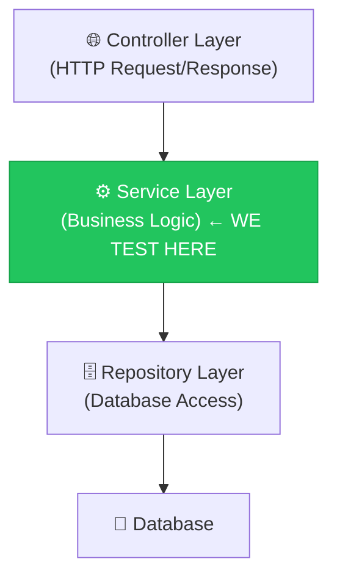

# 🧪 Java Unit Testing — Interview Preparation Guide
## Based on Your ReOwnIX Product Module

---

## 📁 Test Files Created

| File | Tests | What it covers |
|------|-------|---------------|
| [ProductServiceImplTest.java](file:///c:/Users/abhay/eclipse-workspace/app/src/test/java/com/reownix/product/service/impl/ProductServiceImplTest.java) | 17 tests | CRUD + Authorization + Error handling |
| [CategoryServiceImplTest.java](file:///c:/Users/abhay/eclipse-workspace/app/src/test/java/com/reownix/product/service/impl/CategoryServiceImplTest.java) | 11 tests | Simple CRUD operations |

---

## 🏗️ Architecture: What Layer Are We Testing?



> [!IMPORTANT]
> In Unit Tests, we test the **Service Layer** in isolation. We **mock** the Repository Layer so we never touch a real database. This is the #1 testing concept interviewers ask about.

---

## 🔑 The 5 Core Concepts (Memorize These!)

### 1. `@Mock` — Create a Fake Dependency

```java
@Mock
private ProductRepository productRepository;  // ← This is a FAKE repo
```

**Interview Answer:** *"@Mock creates a lightweight proxy object that simulates the behavior of a real dependency. It doesn't connect to a database or perform real operations. We tell it what to return using `when().thenReturn()`."*

### 2. `@InjectMocks` — Create the Real Object Under Test

```java
@InjectMocks
private ProductServiceImpl productService;  // ← This is the REAL service
```

**Interview Answer:** *"@InjectMocks creates the actual object we're testing and automatically injects all @Mock objects into it via constructor injection. So ProductServiceImpl gets fake repositories but its business logic runs for real."*

### 3. `when().thenReturn()` — Stubbing (Control Mock Behavior)

```java
when(userRepository.findByEmail("abhay@test.com"))
    .thenReturn(Optional.of(testOwner));
```

**Interview Answer:** *"This is called stubbing. We're telling the mock: when someone calls findByEmail with this email, return this test user. It's the 'Arrange' step of the AAA pattern."*

### 4. `verify()` — Confirm Interactions Happened

```java
verify(productRepository).save(any(Product.class));           // Was save called?
verify(productRepository, never()).save(any());               // Was save NOT called?
verify(productRepository).deleteOffersByProductId(1L);        // Was cleanup done?
```

**Interview Answer:** *"verify() checks that a specific method on a mock was called with expected arguments. It's crucial for testing void methods where there's no return value to assert on."*

### 5. `assertThat()` — Validate Results (AssertJ)

```java
assertThat(result).isNotNull();
assertThat(result.getTitle()).isEqualTo("iPhone 15");
assertThat(results).hasSize(1);
assertThat(results).isEmpty();
```

**Interview Answer:** *"We use AssertJ's assertThat() instead of JUnit's assertEquals() because it's more readable and provides better error messages. The fluent API reads like English."*

---

## 🧪 The AAA Pattern (Every Test Follows This!)

```
┌─────────────────────────────────────────────────────┐
│  ARRANGE  →  Set up test data & mock behavior       │
│  ACT      →  Call the method being tested           │
│  ASSERT   →  Verify the result / verify interactions│
└─────────────────────────────────────────────────────┘
```

### Example from your code:

```java
@Test
void createProduct_Success() {
    // ── ARRANGE ──
    when(userRepository.findByEmail("abhay@test.com"))
            .thenReturn(Optional.of(testOwner));
    when(categoryRepository.findById(1L))
            .thenReturn(Optional.of(testCategory));
    when(productRepository.save(any(Product.class)))
            .thenReturn(testProduct);

    // ── ACT ──
    ProductResponse result = productService.createProduct("abhay@test.com", createRequest);

    // ── ASSERT ──
    assertThat(result).isNotNull();
    assertThat(result.getTitle()).isEqualTo("iPhone 15");
    verify(productRepository).save(any(Product.class));
}
```

---

## 🚨 Testing the Unhappy Path (Interviewers Love This!)

> [!TIP]
> Always test **both** the happy path (success) AND the unhappy path (errors). Interviewers specifically ask: *"How do you test exception scenarios?"*

### Pattern: `assertThatThrownBy()`

```java
@Test
void createProduct_UserNotFound_ThrowsException() {
    // Return empty = user doesn't exist
    when(userRepository.findByEmail("nonexistent@test.com"))
            .thenReturn(Optional.empty());

    // This lambda SHOULD throw an exception
    assertThatThrownBy(() ->
            productService.createProduct("nonexistent@test.com", createRequest)
    )
            .isInstanceOf(UserNotFoundException.class)    // Check exception TYPE
            .hasMessage("user not found");                // Check exception MESSAGE

    // Save should NEVER be called if user doesn't exist
    verify(productRepository, never()).save(any());
}
```

---

## 🎯 Advanced: ArgumentCaptor (Impress the Interviewer!)

> [!NOTE]
> `ArgumentCaptor` lets you capture the exact argument passed to a mock method. This is useful when the method creates an object internally and you want to inspect it.

```java
@Test
void createProduct_SetsStatusToAvailable() {
    // ... arrange mocks ...
    
    // Create a "net" to capture what gets passed to save()
    ArgumentCaptor<Product> captor = ArgumentCaptor.forClass(Product.class);

    // Act
    productService.createProduct("abhay@test.com", createRequest);

    // Capture what was saved
    verify(productRepository).save(captor.capture());
    Product savedProduct = captor.getValue();

    // Now inspect the captured object
    assertThat(savedProduct.getStatus()).isEqualTo(ProductStatus.AVAILABLE);
    assertThat(savedProduct.getOwner()).isEqualTo(testOwner);
}
```

**Interview Answer:** *"ArgumentCaptor is used when the method under test creates or modifies an object internally before passing it to a dependency. We capture it to verify that the internal transformation was done correctly."*

---

## 🔐 Testing Authorization Logic

Your `ProductServiceImpl` has ownership checks. Here's the pattern:

```java
@Test
void updateProduct_NotOwner_ThrowsUnauthorized() {
    // User with id=2 tries to update product owned by id=1
    when(userRepository.findByEmail("john@test.com"))
            .thenReturn(Optional.of(anotherUser));     // id=2
    when(productRepository.findById(1L))
            .thenReturn(Optional.of(testProduct));      // owner.id=1

    assertThatThrownBy(() ->
            productService.updateProduct(1L, "john@test.com", updateRequest)
    )
            .isInstanceOf(UnauthorizedException.class);

    // CRITICAL: Must NOT save if unauthorized!
    verify(productRepository, never()).save(any());
}
```

---

## 📋 Common Interview Questions & Answers

### Q1: "What is the difference between `@Mock` and `@InjectMocks`?"

> **A:** `@Mock` creates a fake object of a dependency (like a repository). `@InjectMocks` creates the REAL object under test and injects all `@Mock` objects into it. So if `ProductServiceImpl` needs 4 repositories, we create 4 `@Mock`s and 1 `@InjectMocks`.

### Q2: "What is the difference between Unit Testing and Integration Testing?"

> **A:** 
> | | Unit Test | Integration Test |
> |---|---|---|
> | **Scope** | Tests one class in isolation | Tests multiple layers together |
> | **Dependencies** | Mocked with `@Mock` | Real (DB, server, etc.) |
> | **Speed** | Very fast (milliseconds) | Slower (needs app context) |
> | **Annotation** | `@ExtendWith(MockitoExtension.class)` | `@SpringBootTest` |
> | **Database** | None (mocked) | In-memory (H2) or real |

### Q3: "Why do you use `verify(repo, never()).save(any())` in error tests?"

> **A:** Because in error scenarios, the method should throw an exception BEFORE reaching the save call. If save IS called, it means our validation logic is broken. `never()` ensures the method was NOT invoked — this is defensive testing.

### Q4: "What is the AAA pattern?"

> **A:** Arrange-Act-Assert. Arrange = set up test data and mock behavior. Act = call the method under test. Assert = verify the output or interactions. Every well-structured test follows this pattern.

### Q5: "How do you test void methods?"

> **A:** Since void methods don't return anything, we use `verify()` to confirm the correct interactions happened. For example, for `deleteProduct()`, we verify that `productRepository.delete()` was called with the right argument.

### Q6: "What is `@BeforeEach` and why do you use it?"

> **A:** `@BeforeEach` runs before every test method. I use it to create fresh test data (User, Product, Category objects) so each test starts with clean state. This prevents test pollution — one test's modifications don't affect another.

### Q7: "What is `@Nested` and why do you use it?"

> **A:** `@Nested` groups related tests into inner classes. For example, all `createProduct` tests are in one `@Nested` class, all `deleteProduct` tests in another. This makes test reports cleaner and tests easier to find.

### Q8: "What is `any()` in Mockito?"

> **A:** `any()` is an argument matcher that matches ANY argument of that type. `any(Product.class)` matches any Product object. We use it when we don't care about the exact argument — just that the method was called.

### Q9: "When would you use ArgumentCaptor instead of any()?"

> **A:** When I need to inspect the EXACT object passed to a mock. For example, when `createProduct()` builds a Product internally, I use ArgumentCaptor to capture it and verify fields like `status = AVAILABLE` were set correctly.

### Q10: "What annotations do you need to run Mockito tests?"

> **A:** `@ExtendWith(MockitoExtension.class)` on the test class. This initializes all `@Mock` and `@InjectMocks` annotations automatically. Without it, all mocks would be null.

---

## 🗺️ Test Coverage Map for ProductServiceImpl

| Method | Happy Path ✅ | User Not Found ❌ | Product Not Found ❌ | Category Not Found ❌ | Unauthorized ❌ | Edge Case 🔲 |
|--------|:---:|:---:|:---:|:---:|:---:|:---:|
| `createProduct()` | ✅ | ✅ | — | ✅ | — | Status = AVAILABLE |
| `updateProduct()` | ✅ | ✅ | ✅ | — | ✅ | All fields updated |
| `deleteProduct()` | ✅ | — | ✅ | — | ✅ | Cascade cleanup |
| `getMyProducts()` | ✅ | ✅ | — | — | — | Empty list |
| `getProductById()` | ✅ | — | ✅ | — | — | — |
| `searchProducts()` | ✅ | — | — | — | — | No match → empty |

---

## 🏃 How to Run the Tests

```bash
# Run only Product module tests
.\mvnw.cmd test "-Dtest=com.reownix.product.service.impl.*"

# Run a specific test class
.\mvnw.cmd test "-Dtest=ProductServiceImplTest"

# Run all tests
.\mvnw.cmd test
```

---

## 📝 Key Takeaway for Interviews

> [!IMPORTANT]
> **The #1 thing interviewers look for:** You understand that unit tests should test **business logic in isolation** — mocking all external dependencies, testing both success AND failure paths, and using the AAA pattern consistently.

